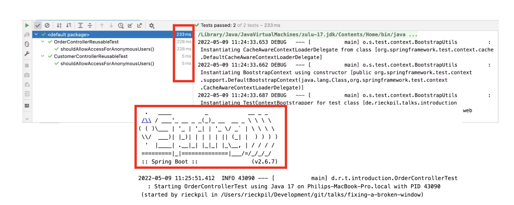
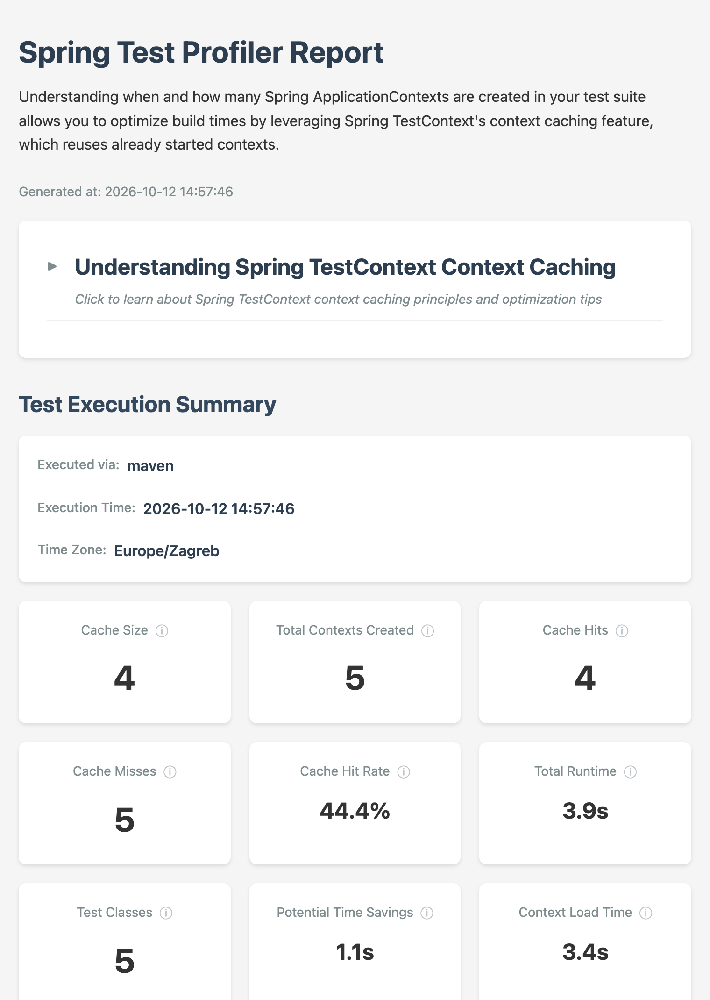

<!-- Menti: https://www.menti.com/alduhjtw1r39 -->
<!-- _paginate: false -->
<!-- _header: '' -->
<!-- _footer: '' -->


---

<!-- _class: light title -->
<!-- _paginate: false -->
<!-- _header: '' -->


# The Need for **Speed**: Cut Your Spring Boot Build Times by 70%

## The hidden gem of Spring Test to unlock blazing fast feedback

JavaCro 2026 · October 13, 2026

<!--
Notes:
- Welcome. Promise: one feature, no new framework, no rewrite.
-->

---

## Let's See Who Has the Fastest Build


<!--
Notes:
- QR leads to https://www.menti.com/alduhjtw1r39 (shared/assets/mentimeter-javacro-2026-first-talk.png).
- The room is long: keep the QR big and centered, give people a moment before moving on.
- Menti questions: Who writes Spring Boot apps? How long does your build take? Do you know Spring's context caching?
-->

---


### About Philip

- Software Engineer from Herzogenaurach (HQ of adidas & Puma), Germany 🍻
- Blogging and content creation about testing Java and Spring Boot applications 🍃
- Founder of [PragmaTech GmbH](https://pragmatech.digital/) - **Enabling Developers to Frequently Deliver** Software with **More Confidence**

---

<!-- _paginate: false -->


# Why Test Software?

---

<!-- _class: light statement reveal -->

<!--
Notes:
- Two clicks. First: most of the code is generated. Pause.
- Then: but you still own the liability, and you can't prompt confidence in your pipeline.
-->

# Most of the code is generated ...
* ... but you still own the liability and **can't prompt** confidence in your pipeline.

---

<!-- _paginate: false -->


## How Much Testing Do We Need?

**No coverage goal**, but **engineering excellence**:

- **Confidence** in every commit
- Being able to **deploy fast** anytime
- **Fast** feedback & **fast** flow

<!--
Notes:
- My northstar: a major Spring Boot upgrade, opened by a bot, green pipeline, merged on a Friday afternoon without fear.
- That only works with a safety net you trust.
-->

---

<style scoped>
.flow { gap: 40px; align-items: stretch; margin-top: 1.2em; }
.sketch {
  flex: 1; padding: 1.4em 1.2em; font-size: 1.7em; line-height: 1.3;
  background: rgba(2, 132, 199, 0.08);
}
.sketch .title { display: block; font-size: 1.6em; margin-bottom: 0.3em; }
</style>

## What We Expect From the Safety Net

<div class="flow">
  <div class="sketch accent"><span class="title">Fast</span>Feedback in <b>minutes</b>, not hours</div>
  <div class="sketch accent alt"><span class="title">Comprehensive</span>The <b>correct types of tests</b> to get confidence</div>
</div>

---

<!-- _class: light statement -->

# Today we focus on **fast** tests.

---

<!-- _class: light reveal -->

<style scoped>
ul { display: grid; grid-template-columns: repeat(3, 1fr); gap: 28px; margin: 0; }
ul > li {
  margin: 0; padding: 0.8em 0.5em; min-height: 11.5em;
  display: flex; flex-direction: column; align-items: center; justify-content: center; gap: 0.25em;
  text-align: center; font-size: 1.45em; line-height: 1.15;
  font-family: 'Architects Daughter', cursive;
  border: 3px solid var(--pt-heading);
  border-radius: 255px 15px 225px 15px / 15px 225px 15px 255px;
  box-shadow: 3px 4px 0 rgba(15, 23, 42, 0.14);
}
ul > li:nth-child(3) { border-color: var(--pt-link); color: var(--pt-link); }
ul > li .icon { font-size: 2.8em; line-height: 1.1; }
ul > li img:not(.emoji) { height: 150px; }
ul > li small { display: block; font-size: 0.8em; line-height: 1.2; color: #000; }
</style>

* <span class="icon">🙈</span>No tests at all<small>fastest build, zero confidence</small>
* <span class="icon">🧵</span>Parallelize tests<small>use all your cores</small>
* Something else ...<small>a treasure that helps us</small>

<!--
Notes:
- Click by click. Box 1 gets the laugh, box 2 is real but needs isolated tests.
- Box 3: the treasure chest. Opens up in the next section: context caching.
-->

---

<!-- _class: light section -->
<!-- _paginate: false -->


<style scoped>
h1 { font-size: 54px; }
</style>

## The Spring Test hidden gem

# Introducing: Spring TestContext Context Caching

---

<!-- _class: light split -->

## What Do These Tests Share?

<div>

```java
@WebMvcTest(BookController.class)
class BookControllerIT {

  @Autowired
  private MockMvc mockMvc;

  @MockitoBean
  private BookService bookService;

  @Test
  void shouldReturnAllBooks() {
    // ...
  }
}
```

</div>

<div>

```java
@SpringBootTest(
  webEnvironment = RANDOM_PORT)
class BookApiIT {

  @Autowired
  private TestRestTemplate template;

  @Autowired
  private BookRepository repository;

  @Test
  void shouldCreateAndFetchBook() {
    // ...
  }
}
```

</div>

<!--
Notes:
- Ask the room. Different annotations, different collaborators, different test types.
- Answer: both need a Spring ApplicationContext before the first test method runs.
-->

---

## The Culprit: Every Test Starts a Context

```text {17}
  .   ____          _            __ _ _
 /\\ / ___'_ __ _ _(_)_ __  __ _ \ \ \ \
( ( )\___ | '_ | '_| | '_ \/ _` | \ \ \ \
 \\/  ___)| |_)| | | | | || (_| |  ) ) ) )
  '  |____| .__|_| |_|_| |_\__, | / / / /
 =========|_|==============|___/=/_/_/_/

 :: Spring Boot ::                (v4.1.1)

14:55:37.602 INFO  BookApiIT : Starting BookApiIT using Java 25.0.2
14:55:37.931 INFO  RepositoryConfigurationDelegate : Bootstrapping Spring Data JPA repositories
14:55:38.218 INFO  TomcatWebServer : Tomcat initialized with port 0 (http)
14:55:38.385 INFO  org.hibernate.orm.core : HHH000001: Hibernate ORM core version 7.4.5.Final
...
14:55:39.060 INFO  LocalContainerEntityManagerFactoryBean : Initialized JPA EntityManagerFactory
...
14:55:39.523 INFO  BookApiIT : Started BookApiIT in 2.034 seconds
```

---

## To Avoid: Linear Build Time Growth


---

<!-- _class: light reveal -->

<style scoped>
ul { display: grid; grid-template-columns: repeat(3, 1fr); gap: 28px; margin: 0.8em 0 0; }
ul > li {
  margin: 0; padding: 0.7em 0.55em; min-height: 11.5em;
  display: flex; flex-direction: column; align-items: center; justify-content: center; gap: 0.35em;
  text-align: center; font-size: 1.5em; line-height: 1.12; font-weight: 700;
  font-family: 'Architects Daughter', cursive;
  color: #000;
  background: #fff;
  border: 3px solid var(--pt-link);
  border-radius: 255px 15px 225px 15px / 15px 225px 15px 255px;
  box-shadow: 3px 4px 0 rgba(15, 23, 42, 0.14);
}
ul > li:nth-child(2) { border-radius: 15px 255px 15px 225px / 225px 15px 255px 15px; }
ul > li .num { font-size: 1.9em; line-height: 1; color: #000; }
</style>

## Understanding the Caching

* <span class="num">1</span>Spring caches an already started context for later reuse
* <span class="num">2</span>A test with a similar context configuration gets a "hot" context handed over
* <span class="num">3</span>No dependency needed, it works out of the box

<!--
Notes:
- Click by click. Part of every Spring Boot project via spring-boot-starter-test.
- Box 2: "similar" means the same cache key, next slides show what goes into it.
-->

---
<!-- _class: light reveal -->

<style scoped>
ul { display: grid; grid-template-columns: 1fr 1fr 1fr; gap: 64px; margin: 1em 0 0; padding: 0; list-style: none; }
ul > li {
  position: relative; display: block; margin: 0 !important; padding: 1em 1.1em !important; min-height: 16em;
  font-size: 0.95em; line-height: 1.45; color: #000; background: #fff;
  border: 3px solid var(--pt-heading);
  border-radius: 255px 15px 225px 15px / 15px 225px 15px 255px;
  box-shadow: 3px 4px 0 rgba(15, 23, 42, 0.14);
}
ul > li::marker { content: none; }
ul > li:not(:first-child)::before {
  content: '→'; position: absolute; left: -64px; width: 64px; top: 50%; transform: translateY(-50%);
  text-align: center; line-height: 1;
  font-family: 'Architects Daughter', cursive; font-size: 2.6em; font-weight: 700; color: var(--pt-link);
}
ul > li:nth-child(3) { border-color: var(--pt-link); background: rgba(2, 132, 199, 0.07); }
.tag { display: block; margin-bottom: 0.5em; font-family: 'Architects Daughter', cursive; font-size: 1.3em; font-weight: 700; line-height: 1.15; color: var(--pt-link); }
.code { display: block; font-family: 'JetBrains Mono', ui-monospace, monospace; font-size: 0.9em; line-height: 1.5; }
</style>

## How Does the Cache Find Your Context?

* <span class="tag">Step 1: Implement a test with a context</span><span class="code">@SpringBootTest<br>class BookApiIT {<br>&nbsp;&nbsp;// ...<br>}</span>
* <span class="tag">Step 2: Spring analyzes your context requirements</span><b>Profiles:</b> default<br><b>Beans:</b> mocks, spies<br><b>Properties:</b> server.port=0<br>...
* <span class="tag">Step 3: Computation of the cache key and trying to look up an existing context</span><b>Cache hit:</b> Reuse hot context<br><b>Cache miss:</b> Your test needs to start the context

<!--
Notes:
- Click by click. Spring does not compare your test classes, it compares the merged configuration.
- Everything that ends up in the configuration is part of the key: profiles, mocks, properties, config classes.
- The class behind the key is MergedContextConfiguration (next slides).
-->

---


<!-- _class: light -->

<style scoped>
.row { display: grid; grid-template-columns: 1.25fr 0.32fr 0.85fr; gap: 12px; align-items: start; margin-top: 0; }
.row p { margin: 0; text-align: center; }
.row pre { margin: 0; }
.row + .row { margin-top: 44px; }
.row img { margin-top: -26px; }
.row .arrow {
  position: relative; align-self: center; justify-self: stretch; margin: 0.5em 14px 0 8px;
  height: 0; border-top: 5px solid var(--pt-link); font-size: 0; color: transparent; transform: none;
}
.row .arrow::after {
  content: ''; position: absolute; right: -4px; top: -12px;
  border-left: 18px solid var(--pt-link); border-top: 9.5px solid transparent; border-bottom: 9.5px solid transparent;
}
</style>

## Each Test Requires a Different Context

<div class="row">

```java
@WebMvcTest(BookController.class)
class BookControllerIT {
  @MockitoBean BookService bookService;
  // ...
}
```

<div class="arrow">→</div>


</div>

<div class="row">

```java
@SpringBootTest(webEnvironment = RANDOM_PORT)
class BookApiIT {
  @Autowired TestRestTemplate template;
  // ...
}
```

<div class="arrow">→</div>


</div>

<!--
Notes:
- Both tests need an ApplicationContext, but not the same one.
- The slice starts only the web layer. @SpringBootTest starts the whole application.
- Different configuration, different cache key, two context starts.
-->

---


## Spring TestContext Caching Behind the Scenes

```java
// DefaultContextCache.java
private final Map<MergedContextConfiguration, ApplicationContext> contextMap =
  Collections.synchronizedMap(new LruCache(32, 0.75f));
```

The cache key is a `MergedContextConfiguration`: **the store of all context customization points** of a test class.

- Spring collects **more than 10 things** to identify a context
- Any change results in a **new hash code** of this Java object
- A new hash code means a cache miss and a new context start

---

<!--
Notes:
- Animated GIF: loops on its own. Let it run one full loop.
- In the exported PDF this shows the first frame only.
-->

## Context Caching in Action


---

## Detect Context Restarts - Visually



---

## Detect Context Restarts - with Logs


---

## Detect Context Restarts - with Tooling


An [open-source Spring Test utility](https://github.com/PragmaTech-GmbH/spring-test-profiler) that provides visualization and insights for Spring Test execution, with a focus on Spring context caching statistics.

**Overall goal**: Identify optimization opportunities in your Spring Test suite to speed up your builds and ship to production faster and with more confidence.

---

<!-- _class: light section -->
<!-- _paginate: false -->

<!--
Notes:
- Quick demo of the report only: ./mvnw verify, open target/spring-test-profiler/latest.html.
- Show the cache hit rate, the timeline and why the contexts differ.
- Activation (dependency and spring.factories) follows on the slides after the three steps.
-->



## Spring Test Profiler

# Demo Time

_A quick look at the report._

---

<!-- _class: light -->

<style scoped>
ul { display: grid; grid-template-columns: repeat(3, 1fr); gap: 28px; margin: 0.8em 0 0; padding: 0; list-style: none; }
ul > li {
  margin: 0; padding: 0.8em 0.7em; min-height: 12.5em;
  display: flex; flex-direction: column; align-items: center; justify-content: center; gap: 0.3em;
  text-align: center; font-size: 1.35em; line-height: 1.2;
  font-family: 'Architects Daughter', cursive;
  color: #000; background: #fff;
  border: 3px solid var(--pt-link);
  border-radius: 255px 15px 225px 15px / 15px 225px 15px 255px;
  box-shadow: 3px 4px 0 rgba(15, 23, 42, 0.14);
}
ul > li:nth-child(2) { border-radius: 15px 255px 15px 225px / 225px 15px 255px 15px; }
ul > li::before, ul > li::marker { content: none; }
ul > li .num { font-size: 1.9em; line-height: 1; }
ul > li .step { font-size: 1.5em; font-weight: 700; color: var(--pt-link); }
</style>

## How to Cut Build Time by 70%

* <span class="num">1</span><span class="step">Understand</span>Measure the context starts with the Spring Test Profiler
* <span class="num">2</span><span class="step">Optimize</span>Align the configurations so contexts get reused
* <span class="num">3</span><span class="step">Ensure</span>Keep it fast, for your team and for your AI agents

---

## The Goal: Steady Build Times


---

<!-- _class: light -->

<style scoped>
.cards { display: grid; grid-template-columns: 1fr 1fr; gap: 40px; margin-top: 1.4em; }
.card {
  padding: 1.1em 0.8em; text-align: center; color: #000; background: #fff;
  border: 3px solid var(--pt-link);
  border-radius: 255px 15px 225px 15px / 15px 225px 15px 255px;
  box-shadow: 3px 4px 0 rgba(15, 23, 42, 0.14);
}
.card:nth-child(2) { border-radius: 15px 255px 15px 225px / 225px 15px 255px 15px; }
.card .big { display: block; font-family: 'Space Grotesk', 'Inter', sans-serif; font-weight: 700; font-size: 2.6em; line-height: 1.1; color: var(--pt-link); }
.card .what { display: block; font-family: 'Architects Daughter', cursive; font-size: 1.5em; margin-top: 0.3em; }
.card .gain { display: block; font-family: 'Architects Daughter', cursive; font-size: 1.2em; margin-top: 0.4em; }
</style>

## Real Results: Builds I Optimized at Clients

<div class="cards">
  <div class="card"><span class="big">26 → 12 min</span><span class="what">build time</span><span class="gain">about 54% faster</span></div>
  <div class="card"><span class="big">15 → 3 min</span><span class="what">build time</span><span class="gain">about 80% faster</span></div>
</div>

<!--
Notes:
- Real client projects, no new framework and no rewrite: aligned context configurations, no @DirtiesContext, shared base class.
- Anonymous on purpose.
-->

---

## Add the Spring Test Profiler

An [open-source Spring Test utility](https://github.com/PragmaTech-GmbH/spring-test-profiler) that visualizes context caching for your test suite:

```xml {2-4}
<dependency>
  <groupId>digital.pragmatech.testing</groupId>
  <artifactId>spring-test-profiler</artifactId>
  <version>0.3.1</version>
  <scope>test</scope>
</dependency>
```

---

## Activate It

`src/test/resources/META-INF/spring.factories`:

```properties
org.springframework.test.context.TestExecutionListener=\
digital.pragmatech.testing.SpringTestProfilerListener
org.springframework.context.ApplicationContextInitializer=\
digital.pragmatech.testing.diagnostic.ContextDiagnosticApplicationInitializer
```

Run the tests, open the report:

```bash
./mvnw verify
open target/spring-test-profiler/latest.html
```

---

## Don't Customize the Context Heavily

- Every `@MockitoBean`, `@MockitoSpyBean`, `@TestPropertySource` or `@ActiveProfiles` variation is **a new context**
- Keep **one shared base class** and one shared test configuration
- Put mocks into shared configuration instead of annotating single test classes
- Slice only where it really pays off, and align the slices as well

---

<!-- _class: light split split-60 -->

## The Fix: One Base Class

```java {1-4}
@SpringBootTest(webEnvironment = RANDOM_PORT)
@AutoConfigureMockMvc
@AutoConfigureTestRestTemplate
abstract class AbstractIntegrationTest {
}

class BookApiIT
    extends AbstractIntegrationTest {
  // no own annotations anymore
}
```

- One annotation set for all tests
- No `@MockitoBean` or `@MockitoSpyBean`
- No extra `properties`

---

<!--
Notes:
- The typical advice from AI and StackOverflow when an integration test is flaky: just dirty the context.
- It is copied into the central base class and silently disables the cache for the whole suite.
-->

## The Final Boss

Developers tend to consult AI/StackOverflow for integration test issues and often copy advice from the internet without knowing the implications:

```java {2}
@SpringBootTest
@DirtiesContext
// this instructs Spring to remove the context from the cache
// and rebuild a new context on every request
public abstract class AbstractIntegrationTest {

}
```

The setup above will **disable** the context caching feature and slow down the builds significantly!

---

## Educate Your Team

- Explain the **cache key**: every new annotation combination costs a context start
- Put shared configuration into **one base class**, and review changes to it
- Treat `@DirtiesContext` and a new `@MockitoBean` like a performance decision
- Don't religiously optimize for only **one context**, a handful works

---

## Educate Your AI Agents Too

Agents write most of the tests now. They need the same rules:

```text
.claude/skills/
├── unit-testing            fast tests without context bloat
├── slice-testing           right-sized Spring context slices
├── integration-testing     extend AbstractIntegrationTest, no new context
└── test-setup-reviewer     flags context cache killers
```

Point the skill to your `AbstractIntegrationTest` and name the antipatterns.

---

## The Profiler Also Writes a JSON Report

`target/spring-test-profiler/results.json` - flat and easy to consume from a pipeline:

```json {7}
{
  "schemaVersion": 1,
  "profilerVersion": "0.3.1",
  "generatedAt": "2026-10-12T12:57:46Z",
  "buildTool": "MAVEN",
  ...
  "contextsCreated": 5,
  "contextCacheHits": 4,
  "contextCacheMisses": 5,
  "contextCacheHitRatio": 0.4444,
  ...
}
```

---

## Let the CI/CD Pipeline Guard the Context Count

Add one step at the end of the pipeline that reads the report:

```bash {3-5}
./mvnw verify

expectedContexts=5
actualContexts=$(jq -r '.contextsCreated' \
  target/spring-test-profiler/results.json)

if [ "$actualContexts" -gt "$expectedContexts" ]; then
  echo "Too many Spring contexts: $actualContexts"
  exit 1
fi
```

---

<!-- _class: light -->

<style scoped>
ul { display: grid; grid-template-columns: repeat(3, 1fr); gap: 28px; margin: 0.8em 0 0; padding: 0; list-style: none; }
ul > li {
  margin: 0; padding: 0.8em 0.7em; min-height: 12em;
  display: flex; flex-direction: column; align-items: center; justify-content: center; gap: 0.3em;
  text-align: center; font-size: 1.3em; line-height: 1.2;
  font-family: 'Architects Daughter', cursive; color: #000; background: #fff;
  border: 3px solid var(--pt-link);
  border-radius: 255px 15px 225px 15px / 15px 225px 15px 255px;
  box-shadow: 3px 4px 0 rgba(15, 23, 42, 0.14);
}
ul > li:nth-child(2) { border-radius: 15px 255px 15px 225px / 225px 15px 255px 15px; }
ul > li::marker { content: none; }
ul > li .icon { font-size: 2.2em; line-height: 1.1; }
ul > li .step { font-size: 1.3em; font-weight: 700; color: var(--pt-link); }
</style>

## Summary

* <span class="icon">🐌</span><span class="step">The problem</span>Every context start costs time, so build time grows with every test class
* <span class="icon">💎</span><span class="step">The gem</span>Context caching: same configuration, same context
* <span class="icon">🚀</span><span class="step">The plan</span>Understand with the profiler, optimize, ensure with CI and skills

---

## Need Help Further Optimizing Your Build?


<!--
Notes:
- Say it out loud: reach out on LinkedIn or by mail, philip@pragmatech.digital.
-->

---

<!-- _class: light -->
<!-- _paginate: false -->
<!-- _header: '' -->
<!-- _footer: '' -->

<style scoped>
section { padding: 0; }
section img { display: block; margin: -36px auto 0; height: 720px; }
</style>


<!--
Notes:
- Feedback via Sessionize: https://sfeedback.com/Xd59D2
- Full screen, leave it up for a moment before the last slide.
-->

---

<!-- _class: light closing -->
<!-- _paginate: false -->
<!-- _header: '' -->
<!-- _footer: '' -->


# Joyful Testing!

Join my **Spring Boot Testing Newsletter** for best practices, recipes and quick wins in your inbox: **rieckpil.de/newsletter**


