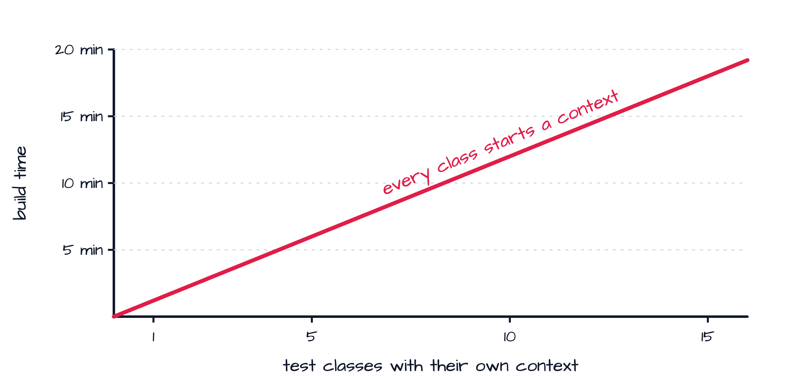
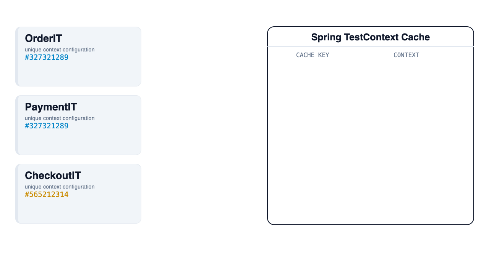
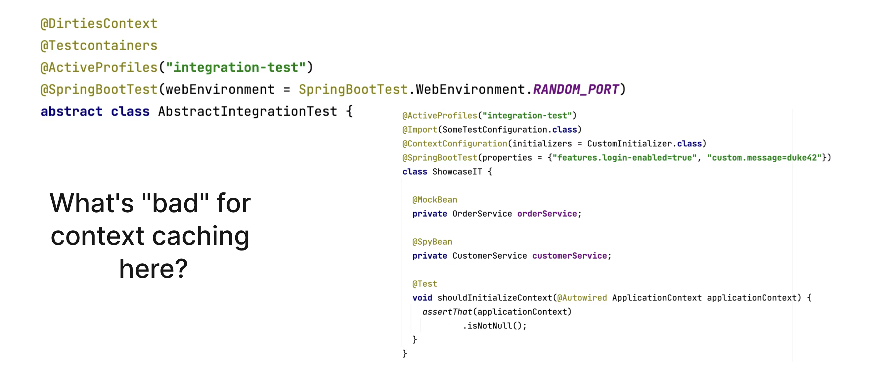
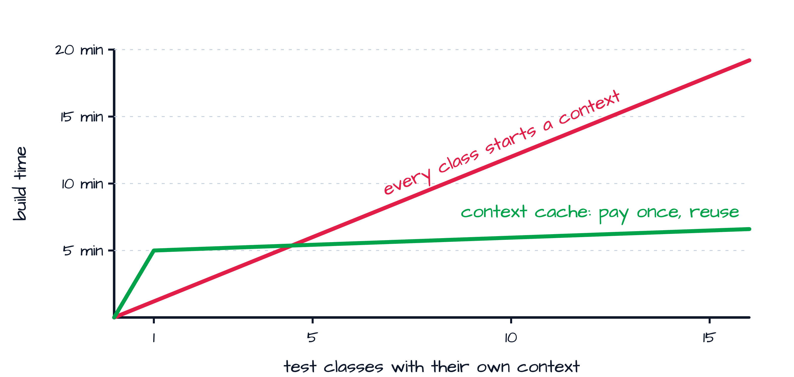
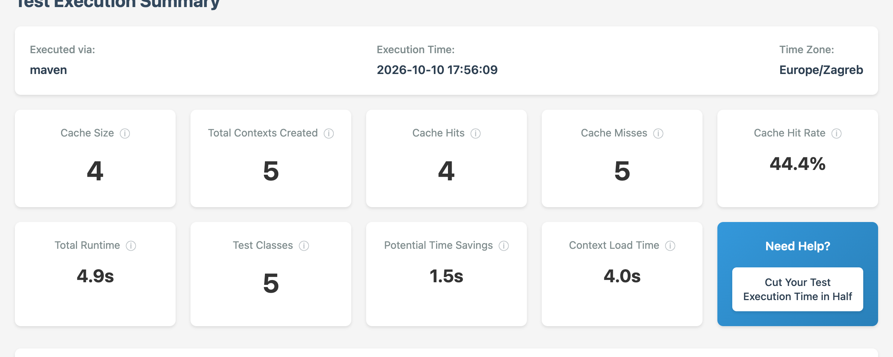
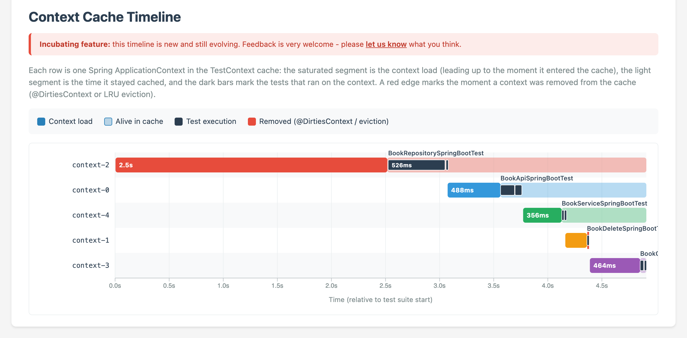
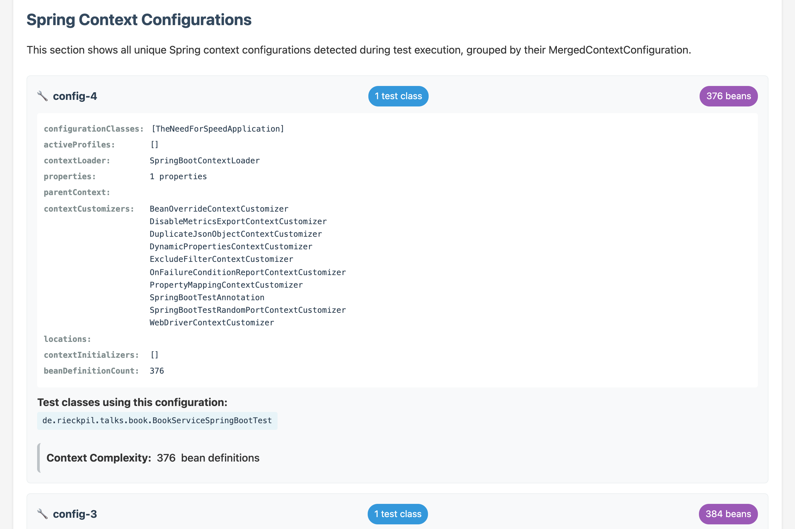
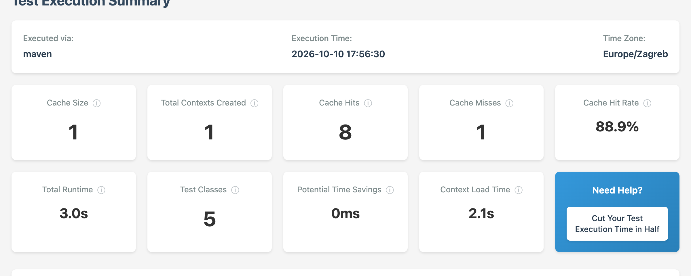
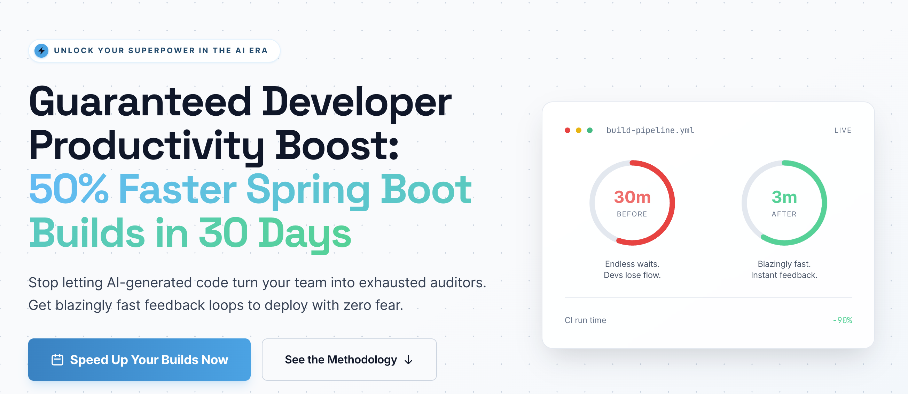

<!-- Menti: https://www.menti.com/alduhjtw1r39 -->
<!-- _paginate: false -->
<!-- _header: '' -->
<!-- _footer: '' -->


---

<!-- _class: light title -->
<!-- _paginate: false -->
<!-- _header: '' -->


# The Need for **Speed**: Cut Your Spring Boot Build Times by 70%

## The hidden gem of Spring Test to unlock blazing fast feedback

JavaCro 2026 · October 13, 2026

<!--
Notes:
- Welcome. Promise: one feature, no new framework, no rewrite.
-->

---

## Let's See Who Has the Fastest Build


<!--
Notes:
- QR leads to https://www.menti.com/alduhjtw1r39 (shared/assets/mentimeter-javacro-2026-first-talk.png).
- The room is long: keep the QR big and centered, give people a moment before moving on.
- Menti questions: Who writes Spring Boot apps? How long does your build take? Do you know Spring's context caching?
-->

---


### About Philip

- Software Engineer from Herzogenaurach (HQ of adidas & Puma), Germany 🍻
- Blogging and content creation about testing Java and Spring Boot applications 🍃
- Founder of [PragmaTech GmbH](https://pragmatech.digital/) - **Enabling Developers to Frequently Deliver** Software with **More Confidence**

---

<!-- _paginate: false -->


# Why Test Software?

---

<!-- _class: light statement reveal -->

<!--
Notes:
- Two clicks. First: most of the code is generated. Pause.
- Then: but you still own the liability, and you can't prompt confidence in your pipeline.
-->

# Most of the code is generated ...
* ... but you still own the liability and **can't prompt** confidence in your pipeline.

---

<!-- _paginate: false -->


<!--
Notes:
- My northstar: a major Spring Boot upgrade, opened by a bot, green pipeline, merged on a Friday afternoon without fear.
- That only works with a safety net you trust.
-->

---

<style scoped>
.flow { gap: 40px; align-items: stretch; margin-top: 1.2em; }
.sketch {
  flex: 1; padding: 1.4em 1.2em; font-size: 1.7em; line-height: 1.3;
  background: rgba(2, 132, 199, 0.08);
}
.sketch .title { display: block; font-size: 1.6em; margin-bottom: 0.3em; }
</style>

## What We Expect From the Safety Net

<div class="flow">
  <div class="sketch accent"><span class="title">Fast</span>Feedback in <b>minutes</b>, not hours</div>
  <div class="sketch accent alt"><span class="title">Comprehensive</span>The <b>correct types of tests</b> to get confidence</div>
</div>

---

<!-- _class: light statement -->

# Today we focus on **fast** tests.

---

<!-- _class: light reveal -->

<style scoped>
ul { display: grid; grid-template-columns: repeat(3, 1fr); gap: 28px; margin: 0; }
ul > li {
  margin: 0; padding: 0.8em 0.5em; min-height: 11.5em;
  display: flex; flex-direction: column; align-items: center; justify-content: center; gap: 0.25em;
  text-align: center; font-size: 1.45em; line-height: 1.15;
  font-family: 'Architects Daughter', cursive;
  border: 3px solid var(--pt-heading);
  border-radius: 255px 15px 225px 15px / 15px 225px 15px 255px;
  box-shadow: 3px 4px 0 rgba(15, 23, 42, 0.14);
}
ul > li:nth-child(3) { border-color: var(--pt-link); color: var(--pt-link); }
ul > li .icon { font-size: 2.8em; line-height: 1.1; }
ul > li img:not(.emoji) { height: 150px; }
ul > li small { display: block; font-size: 0.8em; line-height: 1.2; color: #000; }
</style>

* <span class="icon">🙈</span>No tests at all<small>fastest build, zero confidence</small>
* <span class="icon">🧵</span>Parallelize tests<small>use all your cores</small>
* Something else ...<small>a treasure that helps us</small>

<!--
Notes:
- Click by click. Box 1 gets the laugh, box 2 is real but needs isolated tests.
- Box 3: the treasure chest. Opens up in the next section: context caching.
-->

---

<!-- _class: light section -->
<!-- _paginate: false -->


<style scoped>
h1 { font-size: 54px; }
</style>

## The Spring Test hidden gem

# Introducing: Spring TestContext Context Caching

---

<!-- _class: light split -->

## What Do These Tests Share?

<div>

```java
@WebMvcTest(BookController.class)
class BookControllerIT {

  @Autowired
  private MockMvc mockMvc;

  @MockitoBean
  private BookService bookService;

  @Test
  void shouldReturnAllBooks() {
    // ...
  }
}
```

</div>

<div>

```java
@SpringBootTest(
  webEnvironment = RANDOM_PORT)
class BookApiIT {

  @Autowired
  private TestRestTemplate template;

  @Autowired
  private BookRepository repository;

  @Test
  void shouldCreateAndFetchBook() {
    // ...
  }
}
```

</div>

<!--
Notes:
- Ask the room. Different annotations, different collaborators, different test types.
- Answer: both need a Spring ApplicationContext before the first test method runs.
-->

---

## The Culprit: Every Test Starts a Context

```text {17}
  .   ____          _            __ _ _
 /\\ / ___'_ __ _ _(_)_ __  __ _ \ \ \ \
( ( )\___ | '_ | '_| | '_ \/ _` | \ \ \ \
 \\/  ___)| |_)| | | | | || (_| |  ) ) ) )
  '  |____| .__|_| |_|_| |_\__, | / / / /
 =========|_|==============|___/=/_/_/_/

 :: Spring Boot ::                (v4.1.1)

10:19:16.157 INFO  BookApiIT : Starting BookApiIT using Java 25.0.2
10:19:16.548 INFO  RepositoryConfigurationDelegate : Bootstrapping Spring Data JPA repositories
10:19:16.863 INFO  TomcatWebServer : Tomcat initialized with port 0 (http)
10:19:17.064 INFO  org.hibernate.orm.core : HHH000001: Hibernate ORM core version 7.4.5.Final
...
10:19:17.824 INFO  LocalContainerEntityManagerFactoryBean : Initialized JPA EntityManagerFactory
...
10:19:18.320 INFO  BookApiIT : Started BookApiIT in 2.289 seconds
```

---

## To Avoid: Linear Build Time Growth



---

<!-- _class: light reveal -->

<style scoped>
ul { display: grid; grid-template-columns: repeat(3, 1fr); gap: 28px; margin: 0.8em 0 0; }
ul > li {
  margin: 0; padding: 0.7em 0.55em; min-height: 11.5em;
  display: flex; flex-direction: column; align-items: center; justify-content: center; gap: 0.35em;
  text-align: center; font-size: 1.5em; line-height: 1.12; font-weight: 700;
  font-family: 'Architects Daughter', cursive;
  color: #000;
  background: #fff;
  border: 3px solid var(--pt-link);
  border-radius: 255px 15px 225px 15px / 15px 225px 15px 255px;
  box-shadow: 3px 4px 0 rgba(15, 23, 42, 0.14);
}
ul > li:nth-child(2) { border-radius: 15px 255px 15px 225px / 225px 15px 255px 15px; }
ul > li .num { font-size: 1.9em; line-height: 1; color: #000; }
</style>

## Understanding the Caching

* <span class="num">1</span>Spring caches an already started context for later reuse
* <span class="num">2</span>A test with a similar context configuration gets a "hot" context handed over
* <span class="num">3</span>No dependency needed, it works out of the box

<!--
Notes:
- Click by click. Part of every Spring Boot project via spring-boot-starter-test.
- Box 2: "similar" means the same cache key, next slides show what goes into it.
-->

---

<!--
Notes:
- Animated GIF: loops on its own. Let it run one full loop.
- In the exported PDF this shows the first frame only.
-->

## Context Caching in Action



---

## How the Cache Key Is Built

```java
// DefaultContextCache.java
private final Map<MergedContextConfiguration, ApplicationContext> contextMap =
  Collections.synchronizedMap(new LruCache(32, 0.75f));
```

This goes into the cache key (`MergedContextConfiguration`):

- activeProfiles (`@ActiveProfiles`)
- propertySourceProperties (`@TestPropertySource`, `properties = ...`)
- contextCustomizers (`@MockitoBean`, `@MockitoSpyBean`, `@DynamicPropertySource`, ...)
- configuration classes, initializers, web environment, etc.

**Every unique combination is a new context start.**

---

## What Is "Bad" for Context Caching Here?



---

<!-- _class: light split -->

## Hit or Miss?

<div class="yes">

### Cache hit: same key

- Same annotations on the test class
- Same properties and profiles
- Same mocks and spies
- Context is reused, cost close to zero

</div>

<div class="no">

### Cache miss: one tiny difference

- Extra `properties = ...` on one class
- A `@MockitoBean` only in one test
- `@DirtiesContext` closes the context
- New context start, pay full price

</div>

---

## The Goal: Steady Build Times



---

<!-- _class: light section -->
<!-- _paginate: false -->

## Demo

# A small Spring Boot CRUD API and its test suite

_Spring Boot 4.1, Java 25, 5 test classes, 9 tests._

---

## The Demo Application

- Book CRUD API: `GET/POST/PUT/DELETE /api/books`
- Spring Web MVC, Spring Data JPA, H2
- 5 test classes, all `@SpringBootTest`, each a little different

| Test class | What is different |
|------------|-------------------|
| `BookApiSpringBootTest` | `RANDOM_PORT` and `TestRestTemplate` |
| `BookControllerSpringBootTest` | `@MockitoBean` and `MockMvc` |
| `BookServiceSpringBootTest` | `@MockitoSpyBean` |
| `BookDeleteSpringBootTest` | `@DirtiesContext` |
| `BookRepositorySpringBootTest` | one extra `property` |

---

<!-- _class: light -->

<style scoped>
ul { display: grid; grid-template-columns: repeat(3, 1fr); gap: 28px; margin: 0.8em 0 0; padding: 0; list-style: none; }
ul > li {
  margin: 0; padding: 0.8em 0.7em; min-height: 12.5em;
  display: flex; flex-direction: column; align-items: center; justify-content: center; gap: 0.3em;
  text-align: center; font-size: 1.35em; line-height: 1.2;
  font-family: 'Architects Daughter', cursive;
  color: #000; background: #fff;
  border: 3px solid var(--pt-link);
  border-radius: 255px 15px 225px 15px / 15px 225px 15px 255px;
  box-shadow: 3px 4px 0 rgba(15, 23, 42, 0.14);
}
ul > li:nth-child(2) { border-radius: 15px 255px 15px 225px / 225px 15px 255px 15px; }
ul > li::before, ul > li::marker { content: none; }
ul > li .num { font-size: 1.9em; line-height: 1; }
ul > li .step { font-size: 1.5em; font-weight: 700; color: var(--pt-link); }
</style>

## Three Steps to Faster Builds

* <span class="num">1</span><span class="step">Understand</span>Measure the context starts with the Spring Test Profiler
* <span class="num">2</span><span class="step">Optimize</span>Align the configurations so contexts get reused
* <span class="num">3</span><span class="step">Ensure</span>Keep it fast, for your team and for your AI agents

---

<!-- _class: light section -->
<!-- _paginate: false -->

## Step 1

# Understand: measure before you guess

---

## Add the Spring Test Profiler

An [open-source Spring Test utility](https://github.com/PragmaTech-GmbH/spring-test-profiler) that visualizes context caching for your test suite:

```xml {2-4}
<dependency>
  <groupId>digital.pragmatech.testing</groupId>
  <artifactId>spring-test-profiler</artifactId>
  <version>0.3.1</version>
  <scope>test</scope>
</dependency>
```

---

## Activate It

`src/test/resources/META-INF/spring.factories`:

```properties
org.springframework.test.context.TestExecutionListener=\
digital.pragmatech.testing.SpringTestProfilerListener
org.springframework.context.ApplicationContextInitializer=\
digital.pragmatech.testing.diagnostic.ContextDiagnosticApplicationInitializer
```

Run the tests, open the report:

```bash
./mvnw verify
open target/spring-test-profiler/latest.html
```

---

<!--
Notes:
- Live demo here: run ./mvnw verify and open the report in the browser.
- Fallback: the screenshots on the next slides.
-->

## The Baseline: 5 Test Classes, 5 Contexts



Cache hit rate 44.4%, **4.0s** of the 4.9s are context startup.

---

## The Timeline: Five Contexts, One per Class



---

## Why Do the Contexts Differ?



---

<!-- _class: light section -->
<!-- _paginate: false -->

## Step 2

# Optimize: from five contexts to one

---

## Three Levers to Reuse Contexts

1. **Abstract integration test class** - one place for all context configuration
2. **Context initializer / `@DynamicPropertySource`** - shared setup, same key for everyone
3. **Fewer mocks and no `@DirtiesContext`** - use real beans and clean up your own data

Align first, then slice only where it really pays off.

---

<!-- _class: light split split-60 -->

## The Fix: One Base Class

```java {1-4}
@SpringBootTest(webEnvironment = RANDOM_PORT)
@AutoConfigureMockMvc
@AutoConfigureTestRestTemplate
abstract class AbstractIntegrationTest {
}

class BookApiSpringBootTest
    extends AbstractIntegrationTest {
  // no own annotations anymore
}
```

- One annotation set for all tests
- No `@MockitoBean` or `@MockitoSpyBean`
- No `@DirtiesContext`
- No extra `properties`

---

<!--
Notes:
- Live demo: git apply optimize-context-caching.patch (or type it), run ./mvnw verify again.
-->

## The Result: 1 Context



Cache hit rate **88.9%**, **1** context created, total runtime 4.9s down to **3.0s**.

---

<!-- _class: light metrics -->

## Demo Result

- **5 → 1** Contexts created
- **44% → 89%** Cache hit rate
- **-39%** Total runtime on a tiny suite

<!--
Notes:
- 4.9s to 3.0s on 9 tests. On a real suite with 50 contexts and heavy startup (databases, containers) the same effect gives the 70% from the title.
-->

---

<!-- _class: light section -->
<!-- _paginate: false -->

## Step 3

# Ensure: keep it fast

---

## Educate Your Team

- Explain the **cache key**: every new annotation combination costs a context start
- Put shared configuration into **one base class**, and review changes to it
- Treat `@DirtiesContext` and a new `@MockitoBean` like a performance decision
- Run the profiler report from time to time, share it in the team

---

## Educate Your AI Agents Too

Agents write most of the tests now. They need the same rules:

```text
.claude/skills/
├── unit-testing            fast tests without context bloat
├── slice-testing           right-sized Spring context slices
├── integration-testing     extend AbstractIntegrationTest, no new context
└── test-setup-reviewer     flags context cache killers
```

Point the skill to your `AbstractIntegrationTest` and name the antipatterns.

---

## Let the Pipeline Guard the Context Count

The profiler writes `target/spring-test-profiler/results.json`:

```bash {3-7}
./mvnw verify

expectedContexts=1
actualContexts=$(jq -r '.contextsCreated' \
  target/spring-test-profiler/results.json)

if [ "$actualContexts" -gt "$expectedContexts" ]; then
  echo "Too many Spring contexts: $actualContexts"
  exit 1
fi
```

A new `@DirtiesContext` or a stray `@MockitoBean` now fails the build.

---

<!-- _class: light -->

<style scoped>
ul { display: grid; grid-template-columns: repeat(3, 1fr); gap: 28px; margin: 0.8em 0 0; padding: 0; list-style: none; }
ul > li {
  margin: 0; padding: 0.8em 0.7em; min-height: 12em;
  display: flex; flex-direction: column; align-items: center; justify-content: center; gap: 0.3em;
  text-align: center; font-size: 1.3em; line-height: 1.2;
  font-family: 'Architects Daughter', cursive; color: #000; background: #fff;
  border: 3px solid var(--pt-link);
  border-radius: 255px 15px 225px 15px / 15px 225px 15px 255px;
  box-shadow: 3px 4px 0 rgba(15, 23, 42, 0.14);
}
ul > li:nth-child(2) { border-radius: 15px 255px 15px 225px / 225px 15px 255px 15px; }
ul > li::marker { content: none; }
ul > li .icon { font-size: 2.2em; line-height: 1.1; }
ul > li .step { font-size: 1.3em; font-weight: 700; color: var(--pt-link); }
</style>

## Summary

* <span class="icon">🐌</span><span class="step">The problem</span>Every context start costs time, so build time grows with every test class
* <span class="icon">💎</span><span class="step">The gem</span>Context caching: same configuration, same context
* <span class="icon">🚀</span><span class="step">The plan</span>Understand with the profiler, optimize, ensure with CI and skills

---

## Need Help Further Optimizing Your Build?



<!--
Notes:
- Say it out loud: reach out on LinkedIn or by mail, philip@pragmatech.digital.
-->

---

<!-- _class: light closing -->
<!-- _paginate: false -->
<!-- _header: '' -->
<!-- _footer: '' -->


# Joyful Testing!

The **Spring Boot Testing Newsletter**: best practices, recipes and quick wins in your inbox - **rieckpil.de/newsletter**


