<!-- _paginate: false -->
<!-- _header: '' -->
<!-- _footer: '' -->


---

<!-- _class: light title -->
<!-- _paginate: false -->
<!-- _header: '' -->

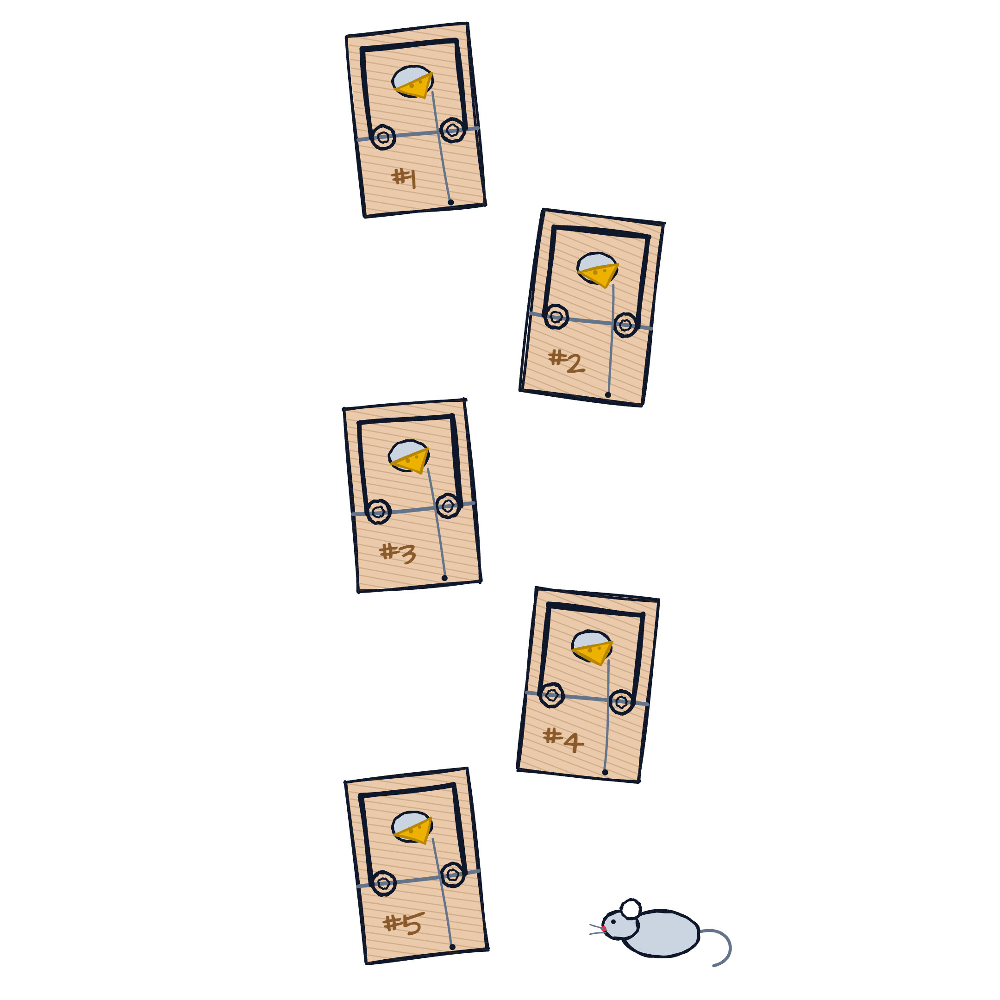

# Top 5 Spring Boot Testing Mistakes **Developers Trap Into**

## Your tests are green. But do you feel confident deploying?

TestCon Europe 2026 · October 23, 2026

---

<!-- footer: '' -->


### About Philip

- Software Engineer from Herzogenaurach (HQ of adidas & Puma), Germany 🍻
- Blogging & content creation with a focus on testing Java and specifically Spring Boot applications 🍃
- Founder of [PragmaTech GmbH](https://pragmatech.digital/) - **Enabling Developers to Frequently Deliver** Software with **More Confidence**

---


<!-- _paginate: false -->


# Why Test Software?

---

<!-- _class: light statement -->
<!-- _paginate: true -->

# In 2026, most of our code is **not written by us**.

---

<!-- _class: light reveal -->

<style scoped>
section > p, section > ul, section > ul > li, section > ul > li > p { margin: 0 !important; padding: 0 !important; text-align: center; }
section img { display: block; margin: 0 auto; }
</style>

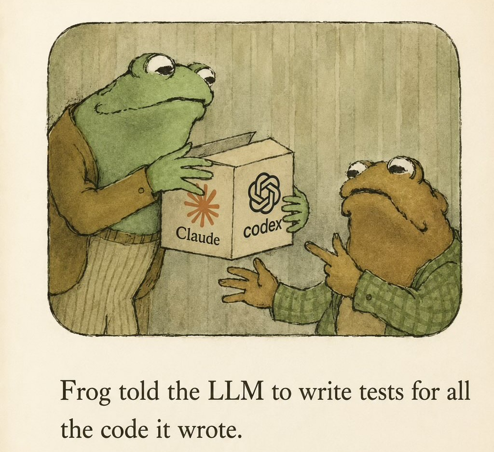

* 
* 
* 

<!--
Notes:
- Three clicks: Frog's plan, Toad's objection, "That is true," said Frog.
- Image is cut into four strips (shared/assets/ai-frog-meme-0N.jpg), PDF shows all at once.
-->

---

<!-- _class: light reveal -->
<!-- _paginate: false -->


### My Overall Northstar for Engineering Excellence

* Imagine seeing this pull request on a Friday afternoon:
* 
* How confident are you to merge this major Spring Boot upgrade and deploy it to production once the pipeline turns green?

---


# Good tests don't just catch bugs - they give you **fast feedback** and **confident deployments**.


---

<!-- _paginate: false -->
<!-- _header: '' -->

<!--
Notes:
- Same five traps, seen from the mouse's point of view.
- Every trap works the same way: the cheese looks free, the snap comes later.
- We are the mouse. The cheese is always a shortcut that feels great today.
-->

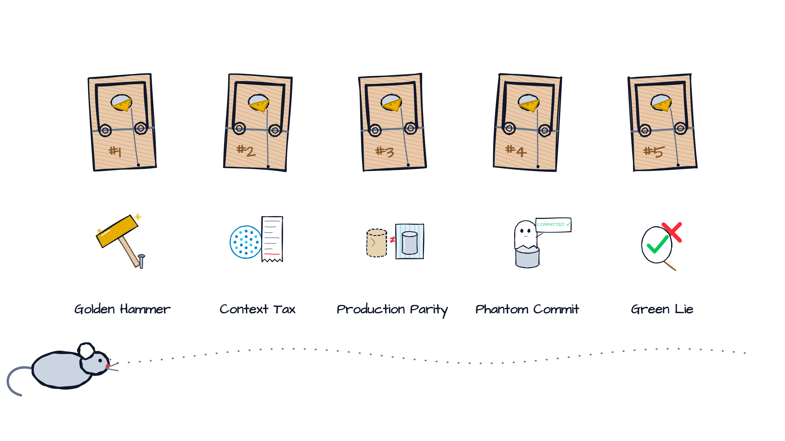

---


<!-- _class: light section -->
<!-- _paginate: true -->


## Testing Trap #1

# The Golden Hammer

_If all you have is a hammer, everything looks like a nail._

---

<!--
Notes:
- Looks fine. Passes. Green. Everybody copies it.
- Ask the room: what does this test actually need?
-->

## The `@SpringBootTest` Obsession


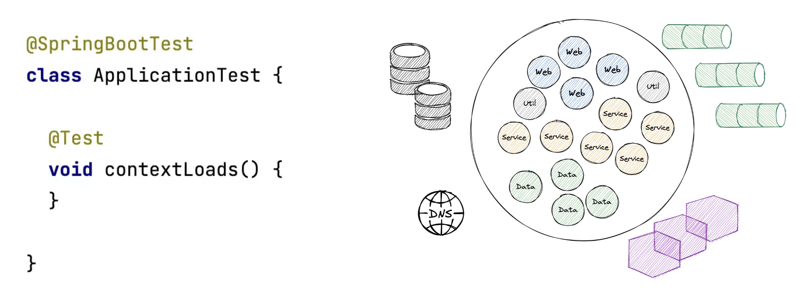

---

## You Don't Always Need the Entire Context

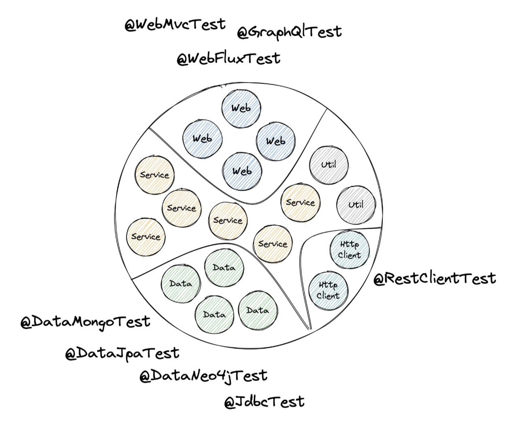

---

## A Decision Tree for Your Spring Test

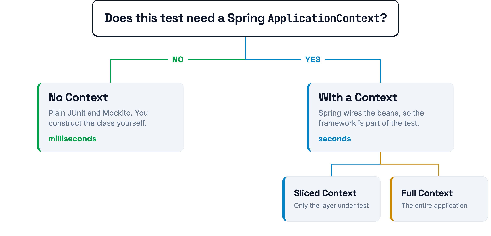

<!--
Notes:
- Two questions: does the test need a Spring ApplicationContext at all? Do we start all of it?
- No context: plain JUnit and Mockito, milliseconds. With a context: seconds. Sliced context for the layer under test, full context for the entire application.
-->

---

## Decision Paralysis: When to Include a Context

A simplified decision table:

| Question                                        | Tool                                           |
|-------------------------------------------------|------------------------------------------------|
| Does my business logic work?                    | Plain JUnit + Mockito, no Spring               |
| Does my HTTP layer map, validate, serialize?    | `@WebMvcTest`                                  |
| Does my query return what I think?              | `@DataJpaTest`                                 |
| Does my client talk to the remote API?          | `@RestClientTest` (including a mock HTTP server) |
| Does the whole thing start and work end to end? | `@SpringBootTest`                              |

---


<!-- _class: light section -->
<!-- _paginate: true -->

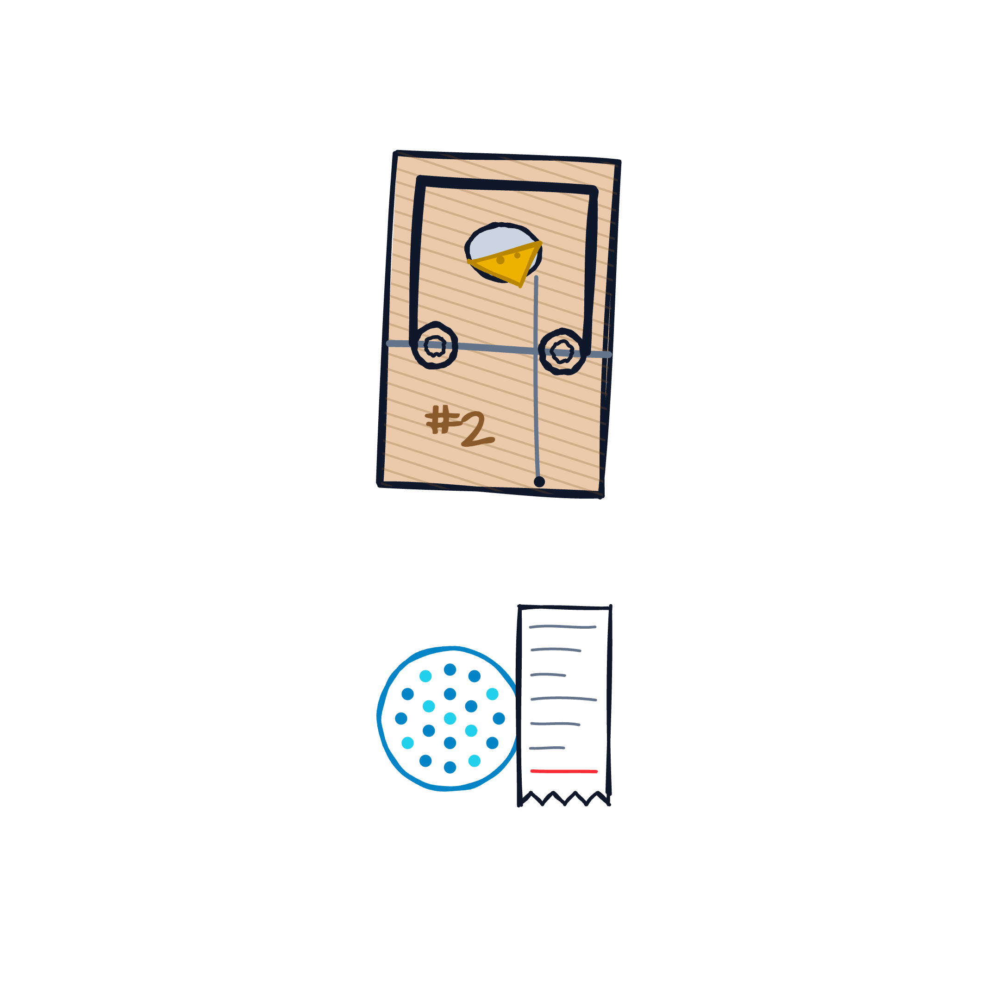

## Testing Trap #2

# The Context Tax

_Every `ApplicationContext` you use for testing, comes with a price._

---

<!--
Notes:
- Three test classes, three different sets of mocks, three contexts.
- The tax is invisible, recurring, and everybody hates it.
-->

<!-- _class: light reveal -->

<style scoped>
section.reveal > ul { list-style: disc; padding-left: 1.2em; }
section.reveal > ul > li { margin: 0 0 0.4em; }
section.reveal > ul > li::marker { content: initial; }
section.reveal > ul:last-of-type { list-style: none; padding: 0; margin-top: 0.6em; }
section.reveal > ul:last-of-type > li::marker { content: ''; }
</style>

## The No. #1 Spring Test Hidden Gem

- Starting the `ApplicationContext` comes with a cost: test execution time
- Every context launch (sliced or full) takes multiple seconds
- Spring Test fixes this with: **TestContext Context Caching**

* Results from one of our clients:

  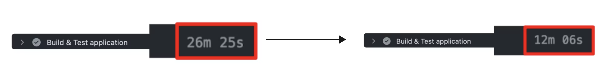

---

<!-- _class: light -->

<style scoped>
.row { display: grid; grid-template-columns: 1.25fr 0.32fr 0.85fr; gap: 12px; align-items: start; margin-top: 0; }
.row p { margin: 0; text-align: center; }
.row pre { margin: 0; }
.row + .row { margin-top: 44px; }
.row img { margin-top: -26px; }
.row .arrow {
  position: relative; align-self: center; justify-self: stretch; margin: 0.5em 14px 0 8px;
  height: 0; border-top: 5px solid var(--pt-link); font-size: 0; color: transparent; transform: none;
}
.row .arrow::after {
  content: ''; position: absolute; right: -4px; top: -12px;
  border-left: 18px solid var(--pt-link); border-top: 9.5px solid transparent; border-bottom: 9.5px solid transparent;
}
</style>

## Each Test Requires a Different Context

<div class="row">

```java
@WebMvcTest(BookController.class)
class BookControllerIT {
  @MockitoBean BookService bookService;
  // ...
}
```

<div class="arrow">→</div>

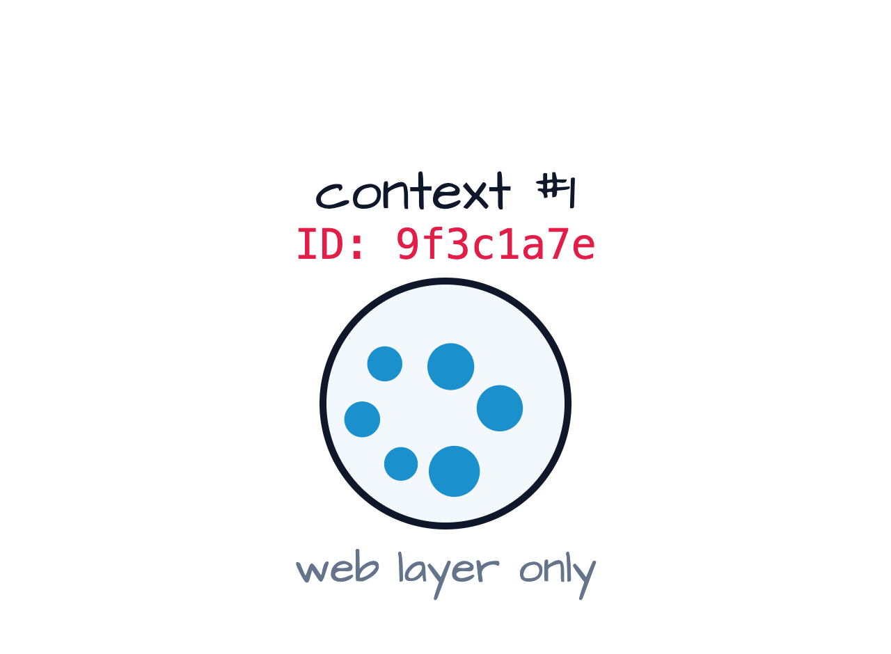

</div>

<div class="row">

```java
@SpringBootTest(webEnvironment = RANDOM_PORT)
class BookApiIT {
  @Autowired TestRestTemplate template;
  // ...
}
```

<div class="arrow">→</div>

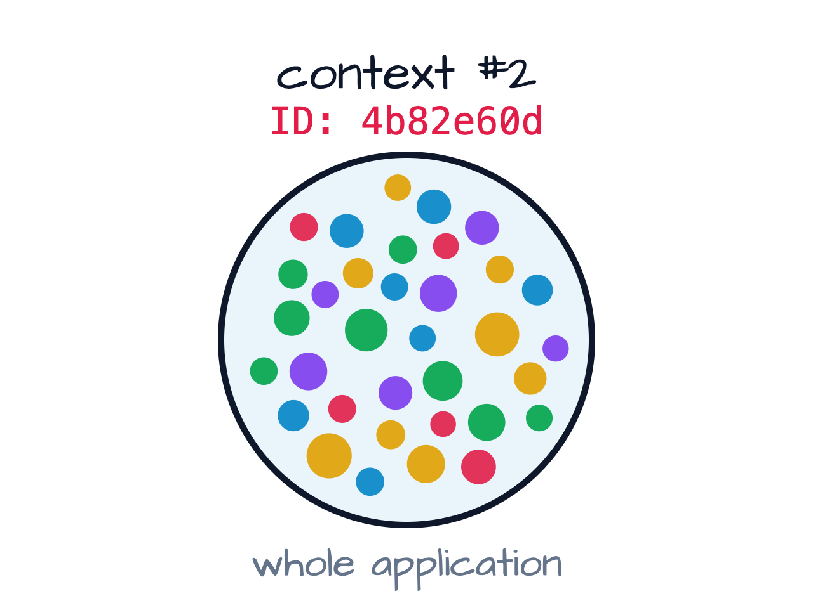

</div>

<!--
Notes:
- Both tests need an ApplicationContext, but not the same one.
- The slice starts only the web layer. @SpringBootTest starts the whole application.
- Different configuration, different cache key, two context starts.
-->

---

## Context Caching in a Nutshell

```java
// DefaultContextCache.java
private final Map<MergedContextConfiguration, ApplicationContext> contextMap =
  Collections.synchronizedMap(new LinkedHashMap<>(32, 0.75f, true));
```

- Spring test builds a unique `ApplicationContext` configuration, by determining which profiles, properties, classes, etc. are included in the test context (stored inside `MergedContextConfiguration`)
- If a subsequent test requires the exact same configuration, Spring simply hands over a "hot" context
- The goal is to reduce the context configuration variety to a bare minimum to have as many cache hits as possible -> fast test execution

---

## How to Identify Context Restarts - Simplified

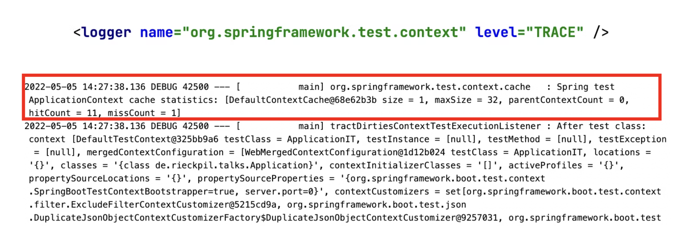

---

## How to Identify Context Restarts - Visualized


An [open-source Spring Test utility](https://github.com/PragmaTech-GmbH/spring-test-profiler) that provides visualization and insights for Spring Test execution, with a focus on Spring context caching statistics.

**Overall goal**: Identify optimization opportunities in your Spring Test suite to speed up your builds and ship to production faster and with more confidence.

---

<!-- _class: light section -->
<!-- _paginate: false -->


## Testing Trap #3

# The Production Parity Trap

_It works on my machine._

---

<!--
Notes:
- The in-memory illusion: H2 in PostgreSQL mode is not PostgreSQL.
- Second flavor: webEnvironment MOCK looks like HTTP but never touches the servlet container.
-->

<!-- _class: light reveal -->

<style scoped>
section.reveal > ul { list-style: disc; padding-left: 1.2em; }
section.reveal > ul > li { margin: 0 0 0.5em; }
section.reveal > ul > li::marker { content: initial; }
</style>

## Where Tests Drift Away From Production

Every test environment takes shortcuts.

Each one is a small drift - and drifts compound:

* **Database**: in-memory H2 instead of the production engine and version
* **Servlet container**: `@SpringBootTest` defaults to a **mocked** servlet environment - `webEnvironment = RANDOM_PORT` starts the real one (Tomcat, etc.)
* **External services**: mocked mail, object storage, message queues, IDPs
* **Schema**: Hibernate `ddl-auto` in tests, Flyway/Liquibase migrations in production
* **Environment**: clock, timezone, locale, JVM flags, OS of the CI runner

---

## The Classic Drift: The In-Memory Database

```java {1,8}
@DataJpaTest
class OrderRepositoryTest {

  @Autowired private OrderRepository orderRepository;

  @Test
  void shouldFindOverdueOrders() {
    // green in two seconds - on an H2 that pretends to be PostgreSQL
  }
}
```

`@DataJpaTest` silently swaps in an embedded database (`replace = Replace.ANY` is the default). H2 in PostgreSQL mode is a **costume, not the engine**.

---

<!-- _class: light reveal -->

<style scoped>
section.reveal > ul { list-style: disc; padding-left: 1.2em; }
section.reveal > ul > li { margin: 0 0 0.5em; }
section.reveal > ul > li::marker { content: initial; }
</style>

## Disarm It: Close the Gap Step by Step

* **Understand your shortcuts**: know where your test environment drifts from production - and decide which drifts you can live with
* **Use Testcontainers**: run the real database, pinned to the production version (`postgres:17.2`) - `@ServiceConnection` wires it up; LocalStack, Kafka, Keycloak, and friends run as containers too
* **Test the app inside Docker**: start the container image you actually ship and run tests against it (JVM flags, base image, OS-level surprises)
* **Canary-test production continuously**: catch what no test environment can - expired SSL certs, rate limits, lost connectivity to cloud resources

---

<!-- _class: light section -->
<!-- _paginate: false -->

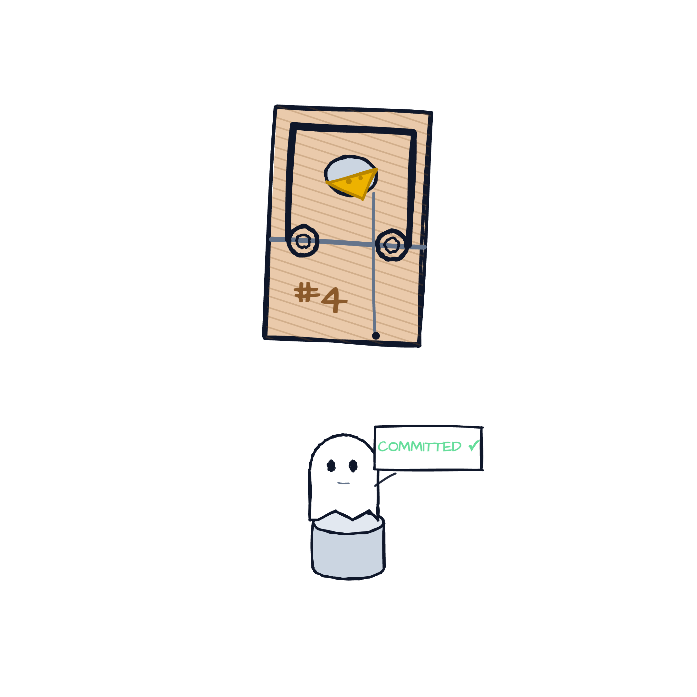

## Testing Trap #4

# The Phantom Commit

_Schrödingers database commit or `LazyInitializationException`._

---

## The Green Test That Proves Nothing

```java
@Entity
public class Customer {

  @Id @GeneratedValue
  private Long id;
  private String email;

  public Customer(String email) { this.email = email; }

  // what's the catch here?
}
```

```java {4}
@Test
void greenButMeaningless() {
  Long id = customerRepository.save(new Customer("duke@pragmatech.digital")).getId();
  assertThat(customerRepository.findById(id)).isPresent(); // green test, failing production
}
```

---

## What Hibernate Does Behind Your Back


```java
// as per JPA spec, entity classes require a default constructor
protected Customer() {

}

@Test
void greenButMeaningless() {
  Long id = customerRepository.save(new Customer("duke@pragmatech.digital")).getId();
  assertThat(customerRepository.findById(id)).isPresent(); // only interacts with first-level cache
}
```

- The entity is **never materialized from a real row**: the missing no-arg constructor stays invisible until the first production query throws `InstantiationException`
- **Persistence context (first-level cache)**: every entity you save or load lives here - `findById` returns the cached instance, **no SQL executed**
- Consider the `TestEntityManager.persistFlushFind()`

---

<!-- _class: light reveal -->

<style scoped>
section.reveal > ul { list-style: disc; padding-left: 1.2em; }
section.reveal > ul > li { margin: 0 0 0.5em; }
section.reveal > ul > li::marker { content: initial; }
</style>

## Be Careful on the Transaction Boundary

* `@Transactional` in a test **rolls back** the transaction : no commit-time constraint checks, no visible change
* `@TransactionalEventListener(phase = AFTER_COMMIT)` **may not fire** in the test
* Lazy loading works inside the test transaction and throws `LazyInitializationException` in production
* The gold standard: `@SpringBootTest(webEnvironment = RANDOM_PORT)` + a real HTTP call - the request runs in its **own transaction**, flushes, commits, and reads real rows

---


<!-- _class: light section -->
<!-- _paginate: false -->

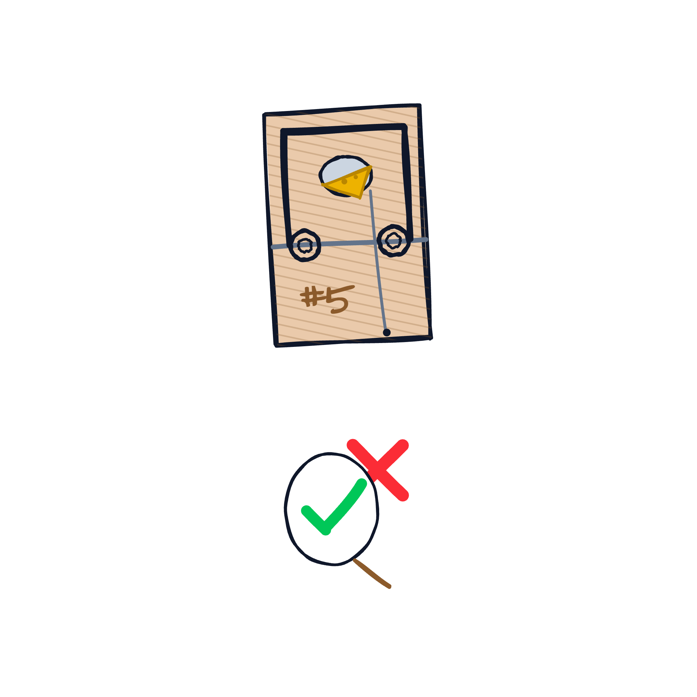

## Testing Trap #5

# The Green Lie

_Never trust a test you haven't seen failing._

---

<!--
Notes:
- AI-era peak: the agent generated 40 tests, coverage is 97%, nobody read them.
-->

## Be Aware of: Watermelon Tests


... green on the outside, red on the inside.

- **100% coverage** and still broken: coverage measures which lines *ran*, not which behavior was *verified*
- A test that asserts the mock works as previously instructed
- Auto-generated tests can give you the **feeling** of safety
- Agents produce these at scale: plausible names, green checks, zero judgment


---

## Let's Challenge Code Coverage

Imagine a set of unit tests for this isolated business logic:

```java
public Long registerUser(int age, String username) {

  if (age <= 18) {
    throw new IllegalArgumentException("User must be at least 18 years old");
  }

  if ("ADMIN".equalsIgnoreCase(username)) {
    throw new IllegalArgumentException("Username 'ADMIN' is not allowed");
  }

  // ...

}
```

---

## Idea: Introduce Regressions to Verify Test Quality


... with the help of PIT:


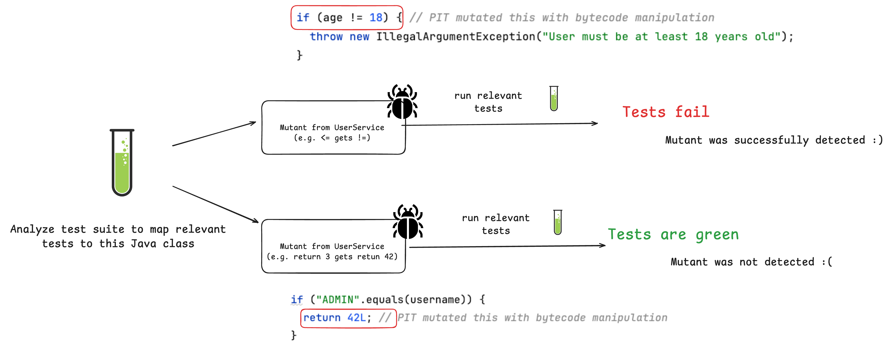


---

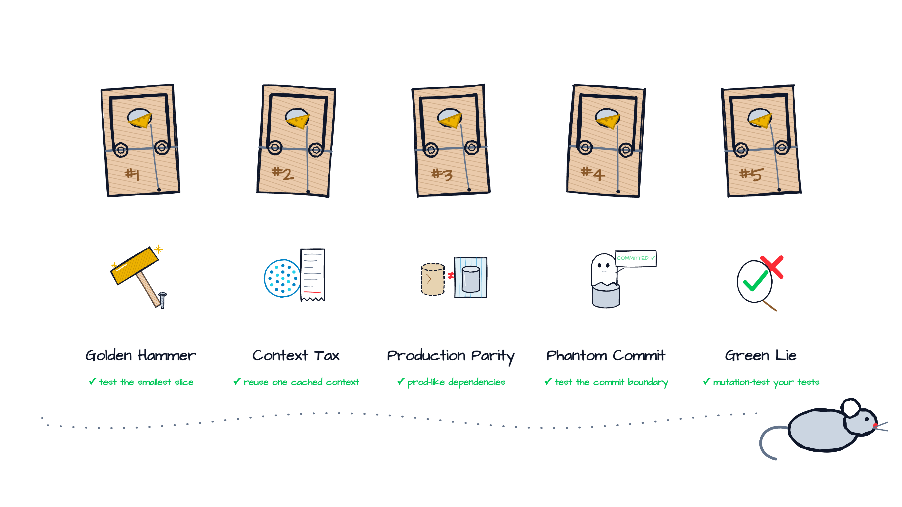

---

<!-- _class: light statement -->
<!-- _paginate: false -->

# AI writes tests in seconds. **Trusting** them still **takes human judgment.**

---

## What I Do to Build Confidence in the Agentic Coding Era

- **Review generated tests** like a pull request from a new hire
- **Put the bridges in the repo**: test slices, shared test configuration, Testcontainers best practices
- **Make the rules executable**: ArchUnit rules, my testing conventions in `CLAUDE.md` / `AGENTS.md`, mutation score thresholds (PIT) in CI
- **Custom skills**: Define once for each project how automated testing is tackled, best practices, antipatterns, etc.
- **Keep the feedback loop tight**: fast, trustworthy tests let the agent iterate without me watching every step (and reduce context switches)

---

## My Agentic Testing Setup for Spring Boot

Define a **skillset** for fast & comprehensive tests, including a **test strategy** for the given project:

```text
.claude/skills/
├── unit-testing            fast tests without context bloat
├── slice-testing           right-sized Spring context slices
├── slice-testing-webmvc    web layer with @WebMvcTest
├── integration-testing     full-context tests that stay fast
├── e2e-testing             user journeys against the running app
├── testcontainers-setup    real infrastructure, reused containers
└── test-setup-reviewer     flags test anti-patterns for you
```

Each skill includes rules, references, best-practices and antipatterns described as code and text.

---

<!-- _class: light statement reveal -->
<!-- _paginate: false -->

<!--
Notes:
- Closing thought, one line per click (fragmented list, works in the HTML deck only).
- The agent can write the code and the tests, but the pager still rings for you.
- Bridge to the closing slide: confidence for every commit is the reason for all five fixes.
-->

# You can delegate the typing.
* You can't delegate the ownership.
* **You** get paged at 3 AM.
* Invest in a test suite that gives you **confidence in every commit**.

---

<!-- _class: light closing -->
<!-- _paginate: false -->
<!-- _header: '' -->


# Ačiū and Joyful Testing!

Join my **Spring Boot Testing Newsletter** for best practices, recipes and quick wins in your inbox: **rieckpil.de/newsletter**


